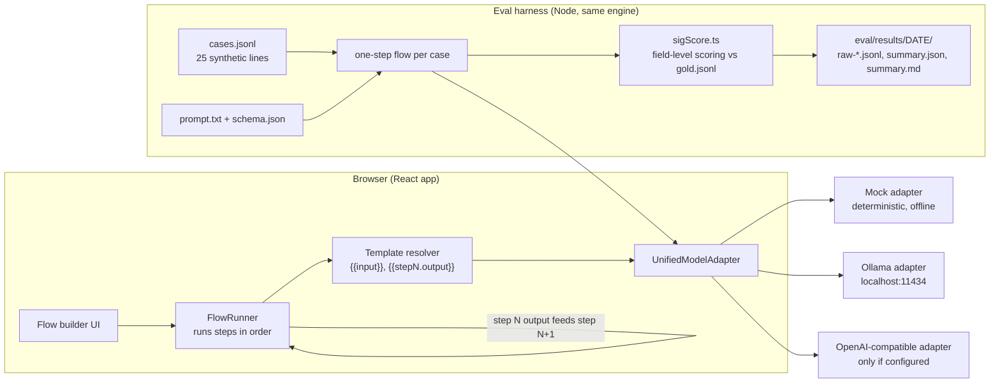

# Local Model Workshop

A browser workshop for picking, testing and chaining small self-hosted AI models on a Mac, with a reproducible eval harness that scores local models against a gold label set.

## Problem

Teams that want to run language models on their own hardware face the same three questions before any build starts: which model fits the machine, what is it good at, and how do you know it is good enough for a specific task. Model cards and leaderboards answer a general version of the last question. They do not answer it for your task, on your hardware, at your latency budget.

This matters most for text that should stay on the machine, such as clinical documentation. Before a model goes anywhere near that kind of work, someone has to show, with a fixed test set and a repeatable method, that it extracts the right fields often enough and fast enough. This repo is a small working version of that loop: a UI for exploring and chaining models, and a harness that turns "this model seems fine" into a measured number.

## How it works

The app is React 18, Vite and Tailwind, written in TypeScript. The app runs entirely in the browser. There is no server and no database. The eval harness runs the same engine under Node.

- **Flow builder.** Chains prompt steps into a linear pipeline. Each step's prompt can reference the original input (`{{input}}`) or an earlier step's output (`{{step1.output}}`). A small engine (`src/engine/`) resolves the templates and sends each step to one of three adapters: a deterministic **mock** (the default, needs nothing installed), a local **Ollama** at `localhost:11434`, or an **OpenAI-compatible** endpoint. The OpenAI adapter sends an API key only if you type one into a step; the key stays in memory and is never stored.
- **Ollama detection.** The app checks for a local Ollama (2 s timeout) and matches each requested model against the installed tags. A playground runs live only on the exact model it asks for. If only a related tag is installed (a different version, size or build), the page names it, explains why it does not qualify, and stays in labeled demo mode.
- **Reference tabs.** A task wizard, a five-model catalog with approximate RAM needs, a hardware advisor that estimates token speed from published chip memory bandwidth (M1 through M4), three macOS Shortcuts recipes, and four playgrounds. Speeds in these tabs are labeled estimates, and playground output is labeled demo output unless a matching model is installed.
- **Eval harness.** `scripts/eval-sig.ts` runs a fixed case set through the same flow engine the UI uses, scores every reply with a tested scorer (`src/eval/sigScore.ts`), and writes raw outputs and a summary to `eval/results/`.



## Evidence

### Tests

Run on 2026-10-30:

| Command | Result |
|---|---|
| `npm test` | 23 files, 312 tests passed (Vitest, jsdom) |
| `npm run test:e2e` | 67 tests passed (Playwright, Chromium) |
| `npm run build` | typecheck and production build succeed |

The unit and browser suites stub the Ollama status probe, so they assert the same thing on every machine whether or not Ollama is installed. `e2e/hermeticity.spec.ts` fails the browser suite if a new spec file skips that stub. The scorer for the eval below has its own tests in `src/eval/sigScore.test.ts`, including a check that every gold label is valid against the schema.

### Measured model comparison

**Task.** Extract six fields from one synthetic medication instruction line: drug name, dose per administration (value and unit), frequency (the schedule), timing (time of day or meal anchor), whether the dose is as needed (`prn`), and the as-needed reason if one is given. Example: `Ibuprofen 200 mg tablets, take 3 tablets by mouth q6h prn pain` should give `ibuprofen`, `600 mg`, frequency `every_6_hours`, timing `null`, prn `true`, indication `pain`. The 25 lines cover plain wording, abbreviations (`PO`, `QHS`, `tid`, `q6h`), dose arithmetic (2 x 500 mg, half tablets, 2 sprays in each nostril), liquids (10 mL of 250 mg/5 mL), meal and time-of-day anchors, and as-needed lines with and without a schedule.

Frequency, timing and as-needed use are separate fields on purpose. "As needed", "once a day" and "once a day as needed" are three different instructions, and the scorer gives each a different answer. The first version of this eval used one `frequency` list that mixed schedules with `at_bedtime` and `as_needed`, so a line with a schedule and "as needed" could only be scored on one of the two. Kevin Madden, PharmD, reviewed the schema and gold labels, found that conflation, and the schema was changed to split the three. The old runs and labels are kept in `eval/results/archive/schema-v1/` with a line-by-line list of label changes. The review covered the test labels, not the models: nothing here is a clinical validation of any model.

**Method.** Each case runs as a one-step flow through the app's `FlowRunner` and Ollama adapter (`npm run eval`). Same prompt for every model (`eval/sig-extraction/prompt.txt`), temperature 0, output constrained by the JSON Schema in `schema.json`. Each model gets one untimed warm-up on a line outside the case set, so load time is excluded, and is unloaded before the next model starts. Latency is wall-clock per request as the adapter sees it. Percentiles are nearest-rank over 25 requests. Each field is scored on its own: drug by whole-word name match, dose by exact number and unit, frequency and timing by exact label (where `null` is a value and must match), prn by exact boolean, indication by whole-word match (`null` must match `null`). A case is all-fields-correct only if all six match.

**Hardware and load.** Apple M1 Max (10 CPU cores), 64 GB unified memory, macOS 27.2, Ollama 0.40.6, Node 24.14.1. The Mac was shared with other workloads. Before each run I waited 15 minutes for the 1-minute load average to drop below 20. It did not: it stayed between 121 and 361 on 10 cores, and I ran anyway. Run 1 started at a 1-minute load of 148 and run 2 at 361. Per-model start and end load is recorded in each `summary.json`. The latencies below are inflated and noisy, and the models did not run under equal load.

**Models.** The three general models installed on the test machine. No model was downloaded for this eval. The two coding-tuned models also installed were not tested. Thinking was turned off where the model allows it. `gpt-oss` cannot turn thinking off, so it ran at its lowest setting, `low`.

Results, 2026-10-30, n=25 per run, two runs per model (`eval/results/2026-10-30-v2-run1/`, `eval/results/2026-10-30-v2-run2/`):

| Model | Size on disk | All fields correct (run 1 / run 2) | Valid JSON | p50 latency (run 1 / run 2) | p95 latency (run 1 / run 2) | 1-min load during run (run 1 / run 2) |
|---|---|---|---|---|---|---|
| Mock (echo baseline) | none | 0/25, 0/25 | 0/25 | n/a | n/a | 144 / 361 |
| `gpt-oss:20b` (20.9B, MXFP4, think=low) | 13.8 GB | 24/25, 24/25 | 25/25 | 6.30 s / 6.17 s | 11.65 s / 11.46 s | 138-217 / 320-352 |
| `gemma4:31b` (31.7B, NVFP4, think=off) | 19.4 GB | **25/25, 25/25** | 25/25 | 7.78 s / 14.14 s | 11.07 s / 20.64 s | 198-201 / 358-468 |
| `qwen3.8:27b` (27.8B, NVFP4, think=off) | 18.2 GB | **25/25, 25/25** | 25/25 | 6.59 s / 9.84 s | 12.59 s / 16.33 s | 206-247 / 340-363 |

Per-field accuracy (identical in both runs for every model):

| Model | Drug | Dose | Frequency | Timing | PRN | PRN indication |
|---|---|---|---|---|---|---|
| Mock (echo baseline) | 0/25 | 0/25 | 0/25 | 0/25 | 0/25 | 0/25 |
| `gpt-oss:20b` | 25/25 | 25/25 | 24/25 | 25/25 | 25/25 | 25/25 |
| `gemma4:31b` | 25/25 | 25/25 | 25/25 | 25/25 | 25/25 | 25/25 |
| `qwen3.8:27b` | 25/25 | 25/25 | 25/25 | 25/25 | 25/25 | 25/25 |

All three models gave the same parsed answer on all 25 cases in both runs.

The mock row is a floor, not a competitor. The app's default mock echoes the prompt, and the scorer gives it nothing. It shows that the harness runs end to end without Ollama and that echoing the input earns no credit.

**Where models missed.** One miss, the same in both runs: `gpt-oss:20b` on `Melatonin 3 mg tab - take 1 tablet by mouth at bedtime as needed for sleep`. It returned frequency `null` (as needed, no schedule) with timing `bedtime` and prn `true`. The gold label is frequency `once_daily`, timing `bedtime`, prn `true`: a bedtime anchor limits the dose to once a day, and the prompt states that a dose tied to one time of day is `once_daily`. This was the label most open to a different reading, so it was put to the pharmacist reviewer directly, who confirmed `once_daily`. Had it been `null`, `gpt-oss:20b` would have scored 25/25, the other two 24/25, and the pick would have changed.

**Decision rubric.** Fixed before these runs, applied in this order.

1. **Correctness gate.** 25/25 on all fields.
2. **Stability.** Same parsed answers across repeat runs.
3. **Latency budget.** p95 at or under 10 s per line on the test machine.
4. **Tie-break.** Smaller memory footprint, then lower p50.

**Result: no model passes all gates under the load these runs had, so the pick is provisional.** `gemma4:31b` and `qwen3.8:27b` pass gates 1 and 2. All three models miss gate 3 in both runs (lowest p95 was 11.07 s), but the 1-minute load average during the model runs was 138 to 468 against a limit of 20, so that gate was not tested fairly.

**Provisional pick: `qwen3.8:27b`.** It ties `gemma4:31b` on correctness and stability, and wins the tie-break: it is 1.2 GB smaller on disk and had the lower p50 in both runs. The size gap is small, so the tie-break is close. Under the first schema this model was rejected because it labeled scheduled as-needed lines (`tid prn itching`) as `as_needed`, against that prompt's rule that the schedule wins. That rule existed only because the old schema forced a choice between schedule and PRN. With the two split, it got both right on every line in both runs. It has to be re-timed on a quiet machine against the 10 s p95 budget before anything depends on it.

- **Runner-up: `gemma4:31b`.** Same accuracy and stability. It loses the tie-break on size and p50, and its latency rose the most from run 1 to run 2, though run 2 also started under the heaviest load.
- **Rejected for now: `gpt-oss:20b`.** It misses the correctness gate on one frequency label, in both runs, and the miss goes against an explicit prompt rule. It was the most consistent on latency under load (p95 about 11.5 s in both runs, slowest case 12.1 s) and is the smallest model. If the re-timing rules out the other two, it is the next choice.

## Design decisions and tradeoffs

- **Mock adapter as the default.** Every flow starts on a deterministic mock, so the app and the full unit and browser test suites run with no model, no network and no key. The cost is that a first-time user sees echo output until they switch a step to Ollama.
- **Exact-model matching instead of "closest installed model".** A playground that answers under a model name it did not run is worse than one that says "demo mode". The app refuses near matches and says why. This makes the live path stricter and sometimes less convenient.
- **The eval goes through the app's own engine.** The harness builds a one-step flow per case and runs it through `FlowRunner` and the same Ollama adapter the UI uses, rather than calling Ollama directly. A regression in template resolution or the adapter shows up as an accuracy drop, not as a silent difference between "the app" and "the benchmark".
- **Separate fields, constrained output, strict scorer.** Schedule, time of day and as-needed use are separate fields. One combined frequency list is simpler, but it cannot tell "as needed" from "once daily as needed" and it hides PRN errors on scheduled lines. Six fields mean a longer prompt and more ways to miss, so each field is reported on its own. Models get the JSON Schema through Ollama's `format` field, with closed vocabularies for unit, frequency and timing and `null` allowed where a line has no schedule or anchor, so the eval measures extraction rather than formatting luck. The scorer still parses defensively and is unit tested, including a case proving it gives no credit to an echo of the prompt.
- **Small, hand-written gold set over a large borrowed one.** Twenty-five lines with known answers, tagged by difficulty (abbreviations, dose arithmetic, liquids, as-needed), are enough to separate models and to read every miss by hand. They are not enough to estimate a real-world error rate (see Limits).

## Limits

- The eval covers one task, 25 synthetic lines, one prompt and two runs per model at temperature 0. With n=25, one miss moves accuracy by 4 points, and p95 is effectively the second-slowest case. Treat the results as a model-selection screen, not an error-rate estimate.
- The gold labels were written for this eval and checked by script for internal consistency (every label is in the schema's vocabulary, every drug name and as-needed reason appears in its input line, and `prn` is true exactly on lines that say "as needed" or "prn"). Schema and labels reviewed by Kevin Madden, PharmD. That review covers the test labels only. It is not a clinical validation of any model, and nothing here should be used for patient care.
- Three labels were judgment calls, and the pharmacist reviewer confirmed each one on 2026-10-30: `at bedtime as needed` (melatonin) is `once_daily` with timing `bedtime`, not `null` (the pick depends on this label); `at bedtime` without "daily" (insulin glargine) is `once_daily`; and `every 12 hours` is a fixed interval, scored as different from `twice_daily`. Another reviewer could still score them differently. Some information has no field and is not scored: "on an empty stomach", "on Mondays", treatment duration ("x 5 days") and the daily maximum ("max 10 tabs/day").
- The models compared are the ones installed on the test machine (20.9B to 31.7B parameters). The 3B to 8B models listed in the catalog were not part of this run.
- Latency was measured on one shared Mac under heavy, uneven load from other workloads. Expect them to run slower than on an idle machine, and read the gaps between models as rough.
- All inputs are synthetic. Nothing here has been tested on real patient text, and the app makes no claim about handling it.
- The hardware advisor and benchmark tab show estimates derived from memory bandwidth, not measurements. The benchmark tab's sample outputs are canned.
- `src/engine/vramLockManager.ts` (a memory-budget queue) is covered by its own tests but not yet used by the UI.
- The harness records wall-clock latency only, not token counts or memory use.
- There is no deploy target. The app runs locally with `npm run dev`.

## Run locally

Tested with Node 24. No accounts, keys or environment variables are needed.

```bash
npm install
npm run dev            # http://127.0.0.1:5176, starts in mock mode
npm test               # unit tests (Vitest, jsdom), no Ollama needed
npx playwright install chromium   # once, for the browser tests
npm run test:e2e       # Playwright; starts the dev server and stubs Ollama
npm run build          # typecheck + production build
```

Evals:

```bash
npm run eval:mock      # mock baseline only; runs without Ollama
npm run eval           # mock + every model in eval/sig-extraction/models.json
npm run eval -- --models gpt-oss:20b --out eval/results/my-run
```

To use live models, install [Ollama](https://ollama.com), pull the models named in `eval/sig-extraction/models.json` (or edit that file), and leave Ollama running on `localhost:11434`. Set `OLLAMA_HOST` to point the eval at a different address.

## License

MIT, Copyright (c) 2026 Kevin Madden. See `LICENSE`. All data in this repository, including the eval cases, gold labels and playground samples, is fictional or synthetic.
