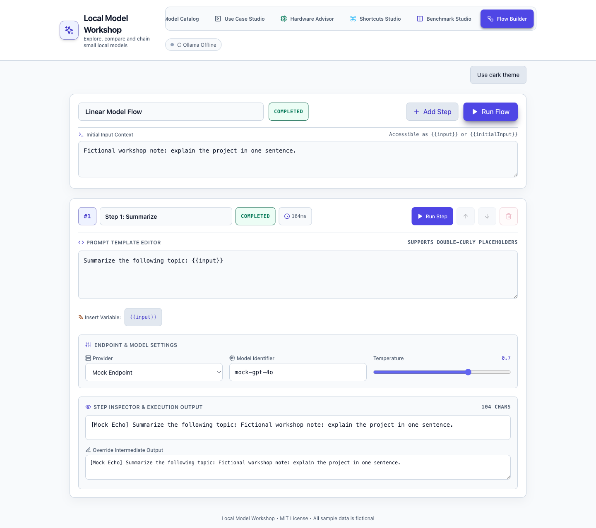
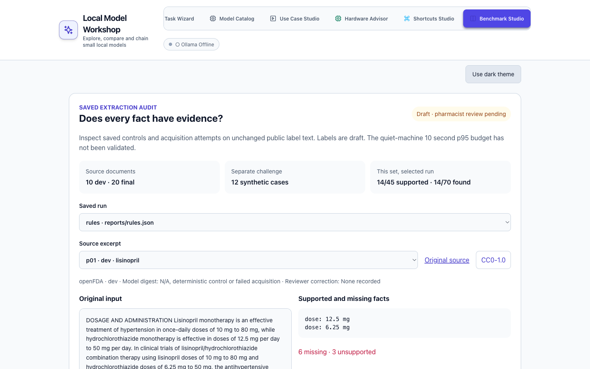

# Can a local model preserve dose, schedule and as-needed meaning within 10 seconds?

**Answer:** historical synthetic runs support a provisional model choice. The new public-text extraction audit is draft, pending pharmacist review, and the quiet-machine 10 second p95 budget remains unvalidated.

| How we test it | Evidence | Limit |
| --- | --- | --- |
| Public label mentions | 10 dev and 20 final unchanged openFDA excerpts, source and rights manifest | Label prose is not a patient prescription |
| Hard instructions | Separate 12-case synthetic challenge with exact spans and arithmetic | New labels are AI-proposed drafts |
| Anti-gaming controls | Empty, extract-everything and narrow rules baselines | Controls are not model quality |
| Extra facts and missing facts | Exact normalized entity sets, per-task denominators, document bootstrap intervals | Small fixed public benchmark, not a blind test |
| Saved-run inspection | Benchmark Studio, source/license links, spans and fixed failure gallery | Rules control is explicitly identified |

[Audit protocol and results](eval/extraction-audit/AUDIT.md) · [Offline control scores](eval/extraction-audit/RESULTS.md) · [How this was built](docs/HOW-BUILT.md)

The inspector uses evaluator v2, which rejects duplicate identities. V1 reports and evaluator source remain frozen under the existing paths and `eval/extraction-audit/versions/v1/source`. Run `npm run audit:qualify:v2 -- --out eval/extraction-audit/versions/v2` only in a fresh output checkout to regenerate v2 evidence from unchanged saved replies; existing output is never overwritten. `npm run audit:score` and `npm run audit:inspect` reproduce and verify v2 artifacts without writing files; `npm test` verifies both versions. Local acquisition is a separate `npm run audit:infer -- --out eval/extraction-audit/local-NEW-ID` command and requires the named models already installed. No paid API is used. All historical results below remain unchanged.

# Local Model Workshop

For product teams deciding whether a local language model is good enough for a defined task. Explore models, run a prompt flow, and inspect a reproducible evaluation before making the choice.

## The problem

A leaderboard cannot tell you whether a model extracts the right information from your task, on your hardware, within your latency budget. For sensitive text, the choice also determines where the text goes and who operates the infrastructure.

## What it does

The workshop lets you match a task to hardware, compare model estimates and chain prompt steps in a flow editor. Start with an offline mock, then configure local Ollama or an OpenAI-compatible endpoint. The evaluation harness uses the same flow engine as the editor and saves raw replies, scores and timing.



The capture shows a completed **mock** flow. It demonstrates the editor, not medication extraction or live model quality. Open Flow Builder and select **Use light theme** to reproduce the appearance.

## How it was tested

The original evaluation uses 25 synthetic medication instructions. It checks drug, dose per administration, schedule, timing, as-needed use and reason. Each model ran twice at temperature zero with JSON-constrained output. Every reply and miss is committed.

**The pharmacist review changed what success meant.** Kevin Madden, PharmD, found that the first schema mixed schedules, bedtime and as-needed use in one field. Splitting them made it possible to preserve both parts of `three times daily as needed`. Qwen, rejected at 23/25 and 24/25 under v1, scored 25/25 in both v2 runs. This is evidence for improving the task definition, not a claim of clinical validation or a model becoming smarter.

A new heldout set adds 12 synthetic instructions with fictional drug names. Its seed, generator and labels were committed before inference. Both unchanged prompts were then run against it, with no tuning. It covers six template families, not the full variety of clinical language. Its generated labels have not had independent pharmacist review.

## Results and the product decision


On the frozen holdout, Qwen scored 9/12 under v1 and 12/12 under v2, Gemma 12/12 under both, and GPT 12/12 then 10/12. Both GPT misses were bedtime as-needed schedule labels. Qwen's new v2 p95 was 12.51 seconds, still above the 10-second budget.

Read the [before and after table on both sets](docs/RESULTS.md), [every model miss with input and output](docs/MISSES.md), and [protocol and trade-offs](docs/EVALUATION.md). The original cases, labels and results remain unchanged, including the [v1 archive](eval/results/archive/schema-v1/README.md).

**No model passed every original gate.** The rubric required perfect correctness, repeat stability and p95 at or below 10 seconds. All models missed that latency budget under heavy, uneven machine load. Qwen is a provisional choice on the original evidence because it tied Gemma on correctness, occupied 1.2 GB less disk space and had lower median latency in both runs. It still needs a quiet-machine timing run.

### Cost and sensitive text

Local inference has no hosted per-request fee, but hardware, electricity, memory and operator time still cost something. The evaluation measures wall-clock latency and disk size, not total operating cost or peak memory. There is no hosted cost or latency benchmark here.

Choose local when inference must stay on a controlled machine and it can meet the task's quality and latency requirements. Verify the endpoint and surrounding storage and access controls. Choose hosted only for text approved for that service under the organization's data and retention rules, when its model options and operational benefits justify usage charges and network dependency. A local deployment alone does not establish safety or compliance. Use synthetic data in this workshop.

### Limits

- These are small synthetic screens, not estimates of real-world clinical error rates. No patient or employer data is used.
- v1 and v2 ask for different fields. Their percentages are not a controlled comparison of the same target.
- The holdout uses new wording and fictional names with familiar task patterns. Its gold is generated from templates, not independently reviewed.
- The original pick depends on a judgment call: bedtime as-needed melatonin is labeled once daily. GPT returned no schedule. The original report explains how another label would change the ranking.
- Historical latency was measured under extreme and unequal load. The new heldout runs are one pass per model and do not establish repeat stability.
- Catalog speeds and sample benchmark outputs are labeled estimates or demos. They are separate from measured eval results.
- Nothing here is validated for patient care.

## Technical detail

React 18, TypeScript, Vite and Tailwind run in the browser without a server or database. `FlowRunner` resolves prompt references and calls the selected mock, Ollama or OpenAI-compatible adapter. The eval uses that same engine under Node. The default mock needs no model, key or network.

Tested with Node 24:

```bash
npm ci
npm run dev                     # localhost:5176, offline mock available
npm test                        # Vitest
npx playwright install chromium # once
npm run test:e2e                 # hermetic browser tests
npm run build                   # typecheck and production build
npm run eval:mock                # original set, no Ollama needed
npm run eval -- --heldout --schema-v1 --out eval/results/my-heldout-v1
npm run eval -- --heldout --out eval/results/my-heldout-v2
node scripts/render-results.mjs  # regenerate chart, table and misses from committed runs
```

Live evaluation needs the already installed models listed in `eval/sig-extraction/models.json` and Ollama at `localhost:11434`. `OLLAMA_HOST` can change that address. Use a new output directory to preserve committed evidence.

See the [original detailed evaluation and architecture](docs/ORIGINAL-EVALUATION.md), [holdout protocol](docs/EVALUATION.md) and [showcase verification](docs/VERIFICATION.md).

## Development history and license

Built in August 2026 over 28 commits in a private repository. This is a cleaned public snapshot. The medication evaluation and schema review were added in October 2026. The showcase adds a frozen holdout and visual documentation without tuning the engine or prompts.

MIT, Copyright (c) 2026 Kevin Madden. All sample data is fictional or synthetic.

## Public extraction inspector

Benchmark Studio now opens the saved-run inspector. It shows public-source rights, exact spans, draft labels, supported and unsupported facts and a fixed failure gallery. The corrected exploratory local acquisition stopped at 23/42 Qwen requests because the shared host could not provide the quiet-machine environment. Two complete corrected timing passes and Kevin's new gold review remain pending. No new model winner or latency-budget claim is published.



[Inspector walkthrough GIF](docs/media/audit-inspector.gif) · [Phone, light](docs/media/audit-light-390.png) · [Phone, dark](docs/media/audit-dark-390.png)
