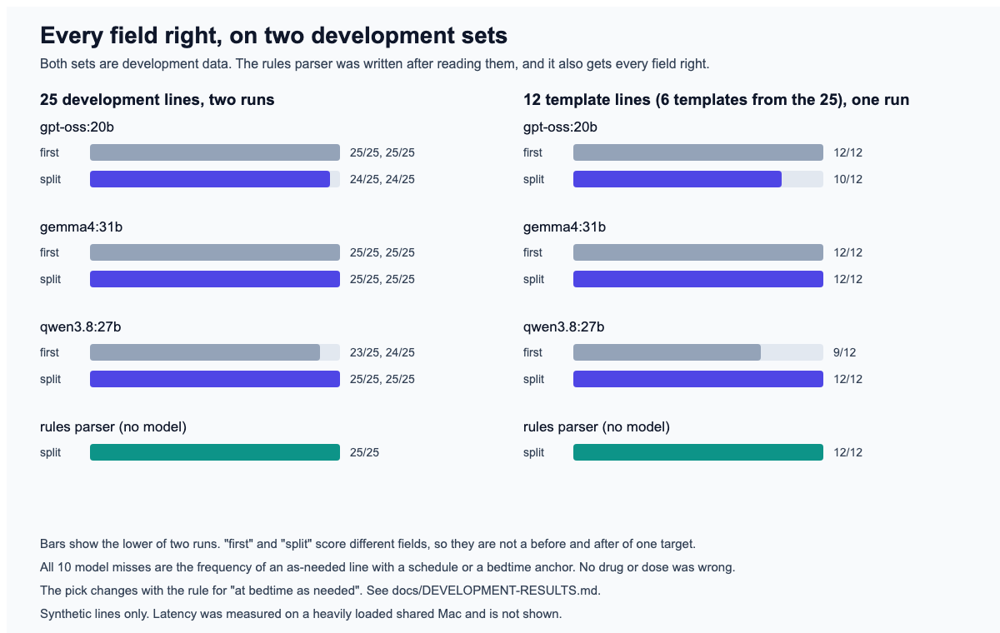

# Local model workshop

A browser workshop for chaining prompt steps against a model on your own Mac, plus a command-line eval that tests local models on synthetic medication instructions through the same engine.

[](https://github.com/kvmadden/local-model-workshop/actions/workflows/ci.yml)

## The honest result

On 37 short, clean synthetic medication lines, three local models (20.9B to 31.7B parameters), run through the app's engine at temperature 0 under a JSON schema, got every field right on 24 to 25 of 25 lines and 10 to 12 of 12 lines.

- **No reading errors.** None of 372 scored answers got the drug or the dose wrong, under the scorers that produced them and under scorer v3.
- **One convention behind every miss.** All 10 misses are the same thing: how the answer format encodes "as needed" next to a schedule or a bedtime anchor.
- **Rules do as well.** A short rules parser also gets every field right on 25 of 25 and 12 of 12.
- **So the sets decide nothing.** They are too regular to rank the models or to show value over rules.
- **Both sets are development data.** The 25 lines are the lines the answer format was revised on. The 12 lines are six templates taken from those 25.
- **One label decided the ranking, and Kevin has ruled on it.** On 3 November 2026 he ruled that "at bedtime as needed" means no fixed schedule, as needed, at most once a day. Under that reading, gpt-oss:20b is the only model with every field right on both sets. Under the rule the gold was first written with, qwen3.8:27b led on disk size. Both are development results.
- **Speed is unmeasured.** No quiet-machine run exists, so performance against the 10-second budget is unknown.

**No model is chosen until the new blind test set runs.** That set is specified in [docs/FRESH-TEST-PROTOCOL.md](docs/FRESH-TEST-PROTOCOL.md) and has not been written yet.



Full tables, intervals, the per-field floor, every miss, the latency facts and the sensitivity of the pick: [docs/DEVELOPMENT-RESULTS.md](docs/DEVELOPMENT-RESULTS.md).

## The pharmacist's contribution

The first answer format put the schedule, bedtime and "as needed" into one frequency field. A line like "hydroxyzine 25 mg tid prn itching" could then be scored on its schedule or on "as needed", never both. Kevin Madden, PharmD, found that conflation and the format was split into frequency, timing, as-needed use and reason.

The model rejected under the first format then got every field right. That change is a better definition of the task, not evidence that a model improved. Because it was made after seeing these lines, those lines became development data.

The same review shows the decision that remains. The split format's `frequency` field still means two things:

- a schedule, for "three times daily"
- a maximum, for "every 6 hours as needed"

Labeling "at bedtime as needed" as `once_daily` follows the prompt, but the audit protocol in this repository says a bedtime anchor is not a schedule. Kevin decided both questions on 3 November 2026 ([docs/KEVIN-REVIEW.md](docs/KEVIN-REVIEW.md)):

- "At bedtime as needed" means no fixed schedule, as needed, at most once a day.
- The schedule and the as-needed maximum are separate fields. The fresh set is labeled that way.

## What the pick depends on

| Rule for "at bedtime as needed" | Lines scored | Latency gate | Pick |
|---|---|---|---|
| Once daily (current gold) | 25 lines | Not applied, as published | qwen3.8:27b, on 1.2 GB less disk |
| Once daily | 25 lines | Applied to the same runs | None. Every p95 was over 10 s on a loaded machine |
| No schedule (Kevin's ruling, and the audit protocol's rule) | 25 lines | Not applied | gpt-oss:20b |
| Once daily | 12 template lines | Applied to the same run | gemma4:31b. qwen's only request over 10 s was its first |
| No schedule | 12 template lines | Applied to the same run | gpt-oss:20b |

Computed from the saved replies by `src/eval/decision.test.ts`. Each row takes correctness and latency from the same runs. No model was run for this table. All eight combinations are in [docs/DEVELOPMENT-RESULTS.md](docs/DEVELOPMENT-RESULTS.md).

## What the workshop does

- **Flow builder.** Chain prompt steps. A step's prompt can use `{{input}}` or an earlier step's output (`{{step1.output}}`). Each step runs on:
  - a built-in mock, the default, which needs nothing installed
  - a local Ollama
  - an OpenAI-compatible server on this Mac, such as LM Studio
- **Local by default, and enforced.** The adapters refuse to send prompt text to any host that is not this machine unless code explicitly sets `allowRemote` (and, for a hosted OpenAI endpoint, an API key). "This machine" means `localhost`, a 127.x.x.x address, `::1` or an IPv4-mapped loopback address. A name that merely ends in `.localhost` does not count. No request that carries prompt text follows a redirect, so a local endpoint cannot pass the prompt on. Running locally does not by itself make anything private or compliant. Storage, logging and network settings still need their own checks.
- **Reference tabs.** A task wizard, a model catalog, a hardware advisor and four playgrounds. Catalog speeds are bandwidth arithmetic, not measurements. Playground output is labeled demo output unless a matching local model ran.
- **Saved-run inspector.** Benchmark Studio opens an inspector for the extraction audit on public label text (below).

## The eval

`scripts/eval-sig.ts` runs each line as a one-step flow through the same FlowRunner and adapter as the app, scores every reply, and writes the raw replies and a summary into a new folder.

```bash
npm run eval -- --help                        # all options
npm run eval:baselines                        # rules, constant, copy and echo baselines, no Ollama needed
npm run eval -- --out eval/results/my-run     # baselines plus every model in eval/sig-extraction/models.json
npm run eval -- --suite templates12 --models gemma4:31b --out eval/results/my-run
npm run eval -- --suite path/to/locked-set.json --out eval/results/fresh-run
```

What the harness does on every run:

- **Never overwrites.** It refuses an existing output folder.
- **Checks before it writes.** A `--models` name that is not in `models.json`, or a model the local Ollama does not have, stops the run before the folder is created. `OLLAMA_HOST` can be written the way Ollama accepts it, such as `127.0.0.1:11434`.
- **Randomizes order.** Case and model order are shuffled from a recorded seed.
- **Times honestly.** It makes two warm-up requests and records whether they failed, reports the first timed request apart, enforces a per-request deadline, and counts failed requests at the time they took.
- **Keeps partial evidence.** Each reply is written to disk as soon as it is scored. A run that stops partway, or is interrupted, still writes a summary marked incomplete.
- **Records provenance.** Before the first request, each summary records hashes of the suite, prompt, schema, model list and every source file the eval imports. At the end it lists any of them that changed during the run, and such a run exits with an error. It also records the git commit, model digest and size, settings and load samples.
- **Reports intervals.** It prints exact 95% intervals and labels both built-in suites as development data.

Scoring uses scorer v3 (`src/eval/sigScoreV3.ts`):

- **Drug.** It needs every gold drug word. An extra word passes only if it is a salt, release or form word in this drug's own description on the line, so "ER" in "(not ER)" or "sodium" in "low sodium diet" does not count. Spellings of one salt or form count as one word (HCl and hydrochloride, ER and extended release), and a digit in a name matches however it is joined (D3 and D-3). Copying a whole instruction line, adding a drug, a negation or a different salt all fail.
- **Reason.** As-needed reasons must match word for word, in order. Only wrapper words around the reason, such as "as needed for", are removed.
- **Dose.** Mass units convert, so 1 g equals 1000 mg. The gold unit is read the same way as the reply unit, and amounts must be finite.
- **Parsing.** A reply that holds several JSON objects is not scored, because the scorer cannot tell which one is the answer.
- **Schema problems** are reported apart from correctness.

The scorers that produced the committed verdicts are kept, and a test re-derives every stored verdict from the saved replies. Scorer v3 gives the same verdicts on every saved split-format reply, and the same drug and dose verdicts on every first-format reply.

## The extraction audit on public label text

A second, unfinished benchmark extracts literal mentions (drug, dose, schedule, timing, as-needed use, reason) from 30 unchanged openFDA dosage sections and 12 synthetic challenge lines, with source and CC0 rights records for each excerpt. Its state:

- **Draft labels, now in two versions.** The labels were AI-drafted. A review flagged 19 likely errors in 18 of the 30 public excerpts, for example methotrexate's missing weekly schedule, "20 mg/m 2" labeled "20 mg", and a creatinine clearance threshold labeled as a dose.
  - Claude proposed the 19 fixes, and Kevin accepted them as a batch on 3 November 2026. They are saved as labels v2 (`eval/extraction-audit/public-v2.json`) beside the unchanged labels v1.
  - No pharmacist has checked the fixes one by one yet, so both versions are still drafts. The frozen protocol keeps v1, and evaluator v3 scores against v2 ([docs/KEVIN-REVIEW.md](docs/KEVIN-REVIEW.md)).
- **The old evaluator measured offsets, not facts.** Evaluator v2 required exact character offsets from the model. On the saved partial run, a line with all five facts right scored 0 of 5 because every offset was one character off.
- **Evaluator v3 separates the two.** It scores facts and evidence separately and accepts quoted evidence ([eval/extraction-audit/V3.md](eval/extraction-audit/V3.md)). On the saved partial run it finds 92 of 134 gold facts with labels v1 and 99 of 129 with labels v2. Both are development data.
- **No result yet.** No complete model run exists. The one exploratory run stopped at 23 of 42 requests.

## Running and testing

Tested with Node 24.

```bash
npm ci
npm run dev                       # http://127.0.0.1:5176, starts in mock mode
npm test                          # unit tests, including evidence re-scoring
npx playwright install chromium   # once
npm run test:e2e                  # browser tests, with Ollama stubbed
npm run build                     # typecheck and production build
npm run audit:score               # reproduce the audit artifacts offline
node scripts/render-results.mjs   # redraw the results chart from the committed summaries
```

The browser app talks to `http://localhost:11434` directly. Ollama accepts requests from localhost pages by default. If you serve the app from any other origin, add only that origin to `OLLAMA_ORIGINS`. Never set it to `*`, which lets any website you visit use your local models.

CI runs the unit tests, the build, the offline audit check, a baselines run and the browser tests on every pull request.

## Limits

- **Small, synthetic and clean.** All lines are synthetic, and both sets are small and too easy. Nothing here is a real-world error rate, and nothing is validated for patient care.
- **Not small models.** The three models are 20.9B to 31.7B parameters (13.8 to 19.4 GB on disk). They were the ones already installed. The 3 to 8B models in the catalog were not run.
- **Unequal settings.** gpt-oss ran with thinking on its lowest setting. The others ran with thinking off. Quantization differs (MXFP4 and NVFP4).
- **Fields not scored.** The six fields do not score route, duration, daily maximum, day of week or administration conditions. Six of the 25 lines contain one of these.
- **Latency.** All timing came from a shared, heavily loaded Mac.
- **Same author.** The prompt, the labels and the pharmacist review are from the same author. Two labels were judgment calls. The fresh protocol uses independent writers and two labelers.

## Documents

- [docs/DEVELOPMENT-RESULTS.md](docs/DEVELOPMENT-RESULTS.md): current tables and their sources.
- [docs/FRESH-TEST-PROTOCOL.md](docs/FRESH-TEST-PROTOCOL.md): the pre-registered blind test set and decision rule.
- [docs/KEVIN-REVIEW.md](docs/KEVIN-REVIEW.md): decisions that need the pharmacist.
- [docs/CORRECTIONS.md](docs/CORRECTIONS.md): claims in the older documents that the evidence does not support, with corrections.
- [eval/sig-extraction/README.md](eval/sig-extraction/README.md) and [eval/heldout/README.md](eval/heldout/README.md): data cards.
- [docs/README.md](docs/README.md): an index of current and historical documents.

The historical documents ([docs/ORIGINAL-EVALUATION.md](docs/ORIGINAL-EVALUATION.md), [docs/EVALUATION.md](docs/EVALUATION.md), [docs/RESULTS.md](docs/RESULTS.md), [docs/MISSES.md](docs/MISSES.md), [docs/VERIFICATION.md](docs/VERIFICATION.md)) are kept byte for byte, because a test checks them against a hash manifest. Read them with [docs/CORRECTIONS.md](docs/CORRECTIONS.md).

## How it was built

Kevin Madden, PharmD, designed the workshop, the task and the schema review. AI coding tools wrote much of the code, tests and documentation, and this revision followed a review by four model families ([docs/HOW-BUILT.md](docs/HOW-BUILT.md)).

MIT, Copyright (c) 2026 Kevin Madden. The eval lines are synthetic. The audit excerpts are public openFDA label text with no patient data.
